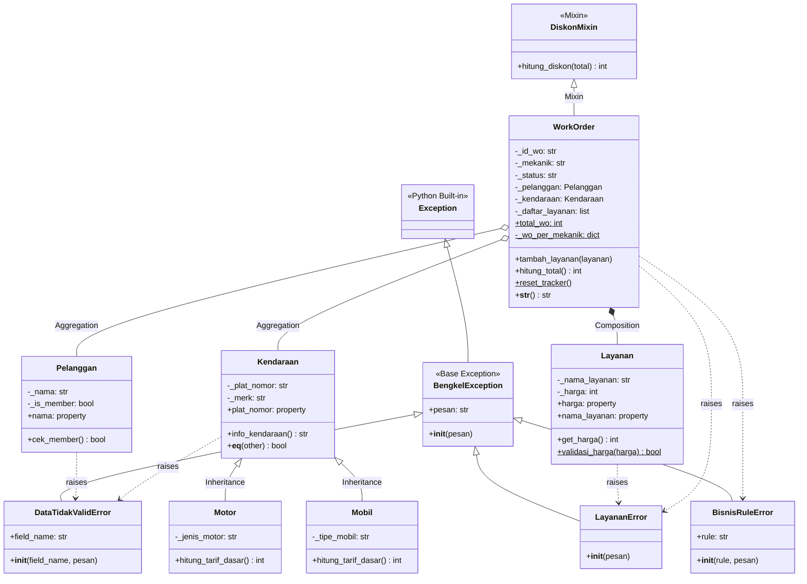

# Sistem Manajemen Bengkel - Exception Handling

## Deskripsi Proyek

Proyek UTS Sistem Manajemen Bengkel yang telah ditambahkan fitur **Exception Handling** (penanganan pengecualian). Sistem ini mengelola pelanggan, kendaraan (motor & mobil), layanan servis, dan work order di sebuah bengkel.

## Hierarki Exception (Custom Exception)

```
Exception (Python built-in)
    └── BengkelException (base exception kustom)
            ├── DataTidakValidError  → data input tidak valid
            ├── BisnisRuleError      → aturan bisnis dilanggar
            └── LayananError         → error terkait layanan
```

## Aturan Bisnis yang Divalidasi

| No | Aturan Bisnis | Exception yang Digunakan | Lokasi Validasi |
|----|---------------|--------------------------|-----------------|
| 1  | Nama pelanggan tidak boleh kosong | `DataTidakValidError` | `Pelanggan.nama` setter |
| 2  | Harga layanan tidak boleh negatif | `LayananError` | `Layanan.harga` setter |
| 3  | Plat nomor harus minimal 4 karakter | `DataTidakValidError` | `Kendaraan.plat_nomor` setter |
| 4  | Mekanik maksimal menangani 3 Work Order | `BisnisRuleError` | `WorkOrder.__init__()` |

## Class Diagram



## Contoh Output

Program akan menjalankan 8 skenario yang mendemonstrasikan:
1. ✅ Alur normal (data valid) → blok `else` dijalankan
2. ❌ Nama kosong → `DataTidakValidError`
3. ❌ Harga negatif → `LayananError`
4. ❌ Plat nomor invalid → `DataTidakValidError`
5. ❌ Mekanik melebihi batas WO → `BisnisRuleError`
6. ❌ Layanan duplikat → `LayananError`
7. ❌ Tangkap semua error dengan `BengkelException` (base)
8. ✅ Perbandingan kendaraan (dunder `__eq__`)

## Struktur Blok Exception Handling

```python
try:
    # Kode yang mungkin menghasilkan exception
    pelanggan = Pelanggan("Budi", True)

except DataTidakValidError as e:
    # Menangani error data tidak valid (exception SPESIFIK)
    print(f"Error: {e}")

except BengkelException as e:
    # Fallback: menangani semua error bengkel (exception UMUM)
    print(f"Error bengkel: {e}")

else:
    # Dijalankan HANYA jika TIDAK ada exception
    print("Berhasil!")

finally:
    # SELALU dijalankan, ada error atau tidak
    print("Proses selesai.")
```

## Anggota Kelompok

| No |              Nama                |   NIM    |
|----|------                            |-----|
| 1  |  I Nyoman Ganendra Maheswara     |2501020069|
| 2  |  Mainaka Lukas Nirang Nawalawatana | 2501020058 |
| 3  |      |     |
